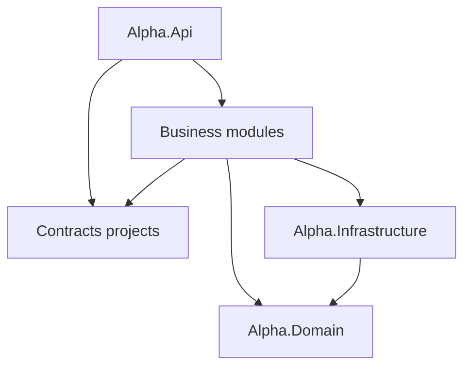

# Alpha architecture

Alpha is a multi-tenant pension-operations backend for the hierarchy **Platform → Organization → Employer → Employee/Employment**. It is a feature-first modular monolith: one ASP.NET Core host, one deployment unit and one PostgreSQL database accessed through a single `AlphaDbContext`.

Modules are compile-time boundaries inside one process. There is no internal HTTP, no distributed transaction and no per-module database.

Related documents: [CODEMAP.md](CODEMAP.md) (where code lives), [security.md](security.md), [database.md](database.md), [development.md](development.md), [release.md](release.md).

## Solution structure

```text
src/
├── Alpha.Api/              HTTP host and composition root
├── Alpha.Domain/           shared domain model (entities, enums, invariants)
├── Alpha.Infrastructure/   AlphaDbContext, EF mappings, schema initializers, advisory lock
└── Modules/
    ├── IdentityAccess/     Alpha.Modules.IdentityAccess (+ .Contracts)
    ├── Organizations/      Alpha.Modules.Organizations
    ├── Workforce/          Alpha.Modules.Workforce
    ├── Billing/            Alpha.Modules.Billing (+ .Contracts)
    ├── Reporting/          Alpha.Modules.Reporting (+ .Contracts)
    ├── ReferenceData/      Alpha.Modules.ReferenceData
    └── Auditing/           Alpha.Modules.Auditing
tests/
├── Alpha.Api.Tests/           behavior, HTTP, security and PostgreSQL integration tests
├── Alpha.Architecture.Tests/  dependency, ownership and production-baseline gates (source only)
└── Alpha.Domain.Tests/        domain invariants
tools/
└── Alpha.SchemaVerifier/      read-only production schema verification (see database.md)
```

## Dependency rules



| Project | May reference |
|---|---|
| `Alpha.Domain` | nothing (no packages, no ASP.NET/EF) |
| `Alpha.Infrastructure` | `Alpha.Domain` only |
| `*.Contracts` | nothing (no project, package or framework references) |
| Business module | Domain, Infrastructure, its own Contracts, **other modules' Contracts only** |
| `Alpha.Api` | everything above; nothing references the host |

The approved graph is listed edge by edge in `tests/Alpha.Architecture.Tests/ProjectDependencyTests.cs`, which also rejects cycles, references to another module's implementation project or namespace, and any reference to `Alpha.Api`.

Current cross-module contracts:

| Contracts project | Types | Consumers |
|---|---|---|
| `IdentityAccess.Contracts` | `ICurrentUser`, `IOrganizationAuthorization`, `IDataProtectionService` | every module, host adapters |
| `Billing.Contracts` | `IEntitlementService`/`EntitlementDecision`, `IBillingInheritanceService`, `ITransmissionBillingGate`, `IPaymentProvider`/`IPaymentProviderResolver` | IdentityAccess, Organizations, Workforce, Reporting, host payment adapters |
| `Reporting.Contracts` | `IReportTransmissionProvider`, `IReportingUsageFactsReader`, `IEmployeeDraftSnapshotSynchronizer` | Billing (usage facts), Workforce (draft snapshot sync) |

Add a contract only when another module must consume a stable capability. Do not add interfaces, repositories or wrappers around `AlphaDbContext` for symmetry.

## Responsibilities

### Alpha.Api (host)

Composition and process concerns only: `Program.cs`, authentication setup (`Authentication/`), reverse-proxy client-IP handling, session validation, security headers, rate limiting, concurrency-conflict handler, the AES data-protection adapter, the sensitive-data backfill (cross-module compatibility job), and payment-provider adapters (`Payments/`: CardCom, PayPlus, Fake, resolver). It owns the two route groups shared by more than one module (`/api/platform`, `/api/reference-data`) and the health probes. It contains no business endpoints; `HostBoundaryTests` enforces this.

### Alpha.Domain

Entities, value rules and state transitions shared by the single database model, grouped by business area: `Auditing`, `Billing`, `Common` (`Entity`, `IsraeliNationalId`), `Employees`, `Employers`, `Identity`, `Organizations`, `Reporting`, `Validation` (employer/employee input rules shared by Workforce and onboarding).

### Alpha.Infrastructure

`AlphaDbContext` (the only `DbContext`), EF configurations, the 31 idempotent schema initializers and their single owner `AlphaDatabaseInitializer`, `OrganizationEntitlementLock` (PostgreSQL advisory locks) and connection-string normalization.

### Business modules

Each module has one facade, `<Module>Module.cs`, with `Add<Module>Module` and `Map<Module>Module`; features live under `Features/<Capability>`, shared module services under `Application/`, provider/technical adapters under `Infrastructure/`.

| Module | Owns |
|---|---|
| IdentityAccess | OTP authentication and sessions, invitations, organization memberships and employer grants, referents, scope, user preferences, platform user administration, organization authorization (`OrganizationAccessService`), OTP delivery, OTP/invitation retention job |
| Organizations | Organization CRUD and memberships API, profile center, dashboard, onboarding (atomic first organization + employer), **Employer Transfer** |
| Workforce | Employers and employees (CRUD/search/status), employer profile settings, employee pension mix |
| Billing | Billing accounts, pricing and self-service plans, billing cycles (service + scheduled job), entitlements and limits, billing inheritance, payment methods and provider callbacks, refunds |
| Reporting | Manual reports and snapshots, attachments and payment evidence, the employer/product 006 document library, payment accounts, Employer Interface 006 (generation, import, validation, Excel, naming), corrections, transmissions and routing, feedback ingestion/resolution/external cases/treatments/exports, 006 public catalogs, TEST-only clearinghouse simulation. Business rules: [reporting.md](reporting.md) |
| ReferenceData | Platform reference-data synchronization and general public catalogs (banks, cities, streets, pension products) |
| Auditing | Security-audit middleware and the platform security-event endpoint (`AuditEvent` itself is in `Alpha.Domain/Auditing`) |

## Data ownership inside the shared DbContext

Every `DbSet` has exactly one owning module (the module that defines its invariants and is its primary writer). Other modules may read or write it only through a reviewed cross-module usage. `ModuleOwnershipTests` holds the ownership map and the exact allow-list of foreign usages per module; any new cross-module data access fails the build until it is reviewed and the list is updated.

The allow-list exists because the domain model is shared and the main business flows genuinely span modules:

- **Authorization** (IdentityAccess) resolves tenant and employer scope from Organizations/Workforce rows.
- **Employer Transfer** (Organizations) moves workforce, reporting, access and billing rows in one transaction.
- **Billing** reads usage, scope and inherited employer settings to price and enforce entitlements; reporting usage comes through `IReportingUsageFactsReader`.
- **Reporting** snapshots workforce data (people, employments, pension mix) into immutable report rows; **Workforce** reads Reporting's document library to refuse deleting a pension product that still has documents.
- Every module appends `AuditEvents`.

## Request flow

```text
HTTP request
  → UseExceptionHandler → HSTS/HTTPS → SecurityHeaders
  → Authentication → SessionActivity (server-side session, active user, admin claim still valid)
  → RateLimiter → Authorization (fallback: authenticated user required)
  → SecurityAudit (correlation ID; audit row for mutations and file/export reads)
  → Reporting input validation (manual-report bodies)
  → module endpoint
      → IOrganizationAuthorization check for the specific organization/employer
      → tenant-scoped EF query (OrganizationId/EmployerId from the route, re-checked against the row)
      → domain invariants, audit event, SaveChanges (one transaction where several writes must be atomic)
```

The middleware order is pinned by `HostBoundaryTests`. Details of each security control are in [security.md](security.md).

## Transactions and concurrency

- One request uses one scoped `AlphaDbContext`. No feature opens a second context or a new DI scope inside an atomic operation.
- Writes that must be atomic use one database transaction. `ExecuteUpdate`/`ExecuteDelete` commit immediately on their own, so any handler that combines them with `SaveChanges` wraps both in a transaction (membership update/removal, employee pension-mix replace, manual-report employee save, Employer Transfer, correction workflow).
- `OrganizationEntitlementLock` takes a transaction-scoped PostgreSQL advisory lock per organization. It serializes entitlement-limited creation (users, employers, employees, imports) and organization access changes (last-admin protection).
- Employer Transfer takes advisory locks for both organizations in a consistent order, re-checks authorization inside the service, updates all dependent rows and commits once. Failure-injection tests prove full rollback.
- EF optimistic concurrency conflicts return the established `409 concurrency_conflict` body.
- Payment idempotency: deterministic idempotency keys per billing period and attempt, unique indexes as the final guard, webhook deduplication by payload hash.

## Cross-module flows

| Flow | Owner | Participants | Mechanism |
|---|---|---|---|
| Onboarding | Organizations | Workforce rows (employer, profile settings), IdentityAccess row (owner employer grant) | one transaction |
| Employer create/update/employee changes | Workforce | Billing (`IEntitlementService`, `IBillingInheritanceService`), Reporting (`IEmployeeDraftSnapshotSynchronizer`) | contracts, same DbContext/transaction |
| Employer Transfer | Organizations | Workforce, Reporting, IdentityAccess, Billing rows | advisory locks + one transaction |
| Report transmission | Reporting | Billing (`ITransmissionBillingGate`) | contract gate before dispatch |
| Billing cycle | Billing | Reporting (`IReportingUsageFactsReader`) | contract read, per-account processing |

## Background processing

Registered by their owning modules: `BillingCycleHostedService` (Billing; off unless `Billing:AutomaticBillingEnabled`), `SecurityRetentionHostedService` (IdentityAccess; deletes only expired OTP challenges and closed invitations), TEST-only clearinghouse/manufacturer simulators (Reporting; only when `EmployerInterface006:ClearinghouseProvider=Simulated`). The host registers `SensitiveDataBackfillHostedService`: a bounded, coordinated, background pass that stops running after its first clean pass ([security.md](security.md#sensitive-data)). Background jobs run without an HTTP user; they operate on explicit IDs and never use client-supplied scope.

## Error handling

Every error response (status 400 and above, except `499` for a client that disconnected) is one RFC 9457 Problem Details document with content type `application/problem+json`:

| Member | Always | Meaning |
|---|---|---|
| `type` | yes | Problem type URI; `about:blank` (status is the type), the RFC 9110 section for the status, or RFC 6585 for 429 |
| `title` | yes | Standard reason phrase for the status |
| `status` | yes | HTTP status code |
| `detail` | yes | Human-readable explanation; business errors keep their established (often Hebrew) text |
| `instance` | yes | Request path |
| `errorCode` | yes | Stable machine code in `UPPER_SNAKE_CASE`; clients branch on this, never on `detail` |
| `traceId` | yes | Request trace identifier, also written to logs and audit rows and returned as the `X-Correlation-ID` header by responses that reach the audit middleware (not by 401/403 answered by authentication or authorization) |
| `errors` | only for `VALIDATION_FAILED` | `{ "<field or request>": ["message", ...] }`; request-level messages use the key `request` |
| `error` | yes, **deprecated** | The pre-A12.3 value of `error` (see the table below) so the current frontend keeps working; remove once the frontend reads `errorCode` |

Business-specific members stay as extensions (for example `invitationId`, `limit`, `current`, `maximum`, `provider`). A member that would collide with a reserved name is renamed; the only case is `status` (a resource status) → `resourceStatus`.

**Where it is produced** (`src/Alpha.Api/Errors`, covered by `ApiErrorContractTests` and `DbConcurrencyExceptionHandlerTests`; `HostBoundaryTests` pins the wiring):

- `ApiErrorResultFilter` on the root route group that every module is mapped under converts a module result with status ≥ 400 and a non-Problem body (`Results.BadRequest(new { error = "..." })`, `Results.Conflict(...)`, `Results.Json(..., statusCode)`) into the contract: a snake_case `error` becomes `errorCode` in upper case; any other `error` text becomes `detail` (for 400 also `errors.request`). Modules keep returning `Results.*`; they never write error bodies themselves.
- A 400 validation message may name the offending request property: `Results.BadRequest(new { error = "<message>", field = "legalName" })` reports the message under `errors.legalName` (camelCase JSON name) instead of `errors.request`; `detail`, `errorCode` and the `error` alias are unchanged. Used by the Workforce employer/employee forms, self-service onboarding, employer reporting settings, platform users, employer roles and appearance preferences. A business rule that is not about one field uses a snake_case code with the text as `detail` (`new { error = "employee_number_exists", detail = "..." }`). Reporting and Billing still return some free-text messages (generic code, text in `detail`).
- `UseStatusCodePages` turns body-less statuses (`Results.NotFound()`, `Forbid()`, authentication challenges, 405/415 from routing, the rate limiter's 429) into the contract.
- `ApiExceptionHandler` maps exceptions (below); anything unmapped becomes 500 `INTERNAL_ERROR`. Logs carry the exception type, status and trace identifier, never the message.
- `ApiErrors.Enrich` (`ProblemDetailsOptions.CustomizeProblemDetails`) completes every Problem Details document, including `Results.Problem(...)` and middleware such as manual-report input validation.

**Codes.** Framework and infrastructure codes are defined in `ApiErrors`: `VALIDATION_FAILED` (400), `MALFORMED_REQUEST` (400, unreadable body or parameters), `AUTHENTICATION_REQUIRED` (401), `AUTH_SESSION_EXPIRED` (401 with `X-Alpha-Session-Expired: true`), `ACCESS_DENIED` (403), `RESOURCE_NOT_FOUND` (404), `METHOD_NOT_ALLOWED` (405), `CONFLICT` (409), `DUPLICATE_RESOURCE` (409, unique violation), `CONCURRENCY_CONFLICT` (409, optimistic concurrency, serialization failure, deadlock), `PAYLOAD_TOO_LARGE` (413), `UNSUPPORTED_MEDIA_TYPE` (415), `RATE_LIMIT_EXCEEDED` (429), `INTERNAL_ERROR` (500), `EXTERNAL_PROVIDER_UNAVAILABLE` (502), `SERVICE_UNAVAILABLE` (503), `EXTERNAL_PROVIDER_TIMEOUT` (504). Business codes are the module's established snake_case codes in upper case (`report_not_editable` → `REPORT_NOT_EDITABLE`, `plan_limit_reached` → `PLAN_LIMIT_REACHED`). 422 is not used; business-rule rejections stay 400 or 409 as before.

Authorization concealment is intentional: resources outside the caller's scope return 403 for the route scope and 404 for IDs that do not belong to it. Anonymous requests to any route, including a wrong method or media type, get 401 because of the default-deny fallback policy.

### Migration from the previous error formats

"Before" is production (`origin/main` at `90c7ba6`). The deprecated `error` member keeps the "before" value wherever production had one.

| Situation | Before | After (`errorCode`) | `error` alias | Client impact |
|---|---|---|---|---|
| Module business error | `{ "error": "report_not_editable", ...extras }` | `REPORT_NOT_EDITABLE`, extras kept | `report_not_editable` | Content type is now `application/problem+json`; read `errorCode` |
| Module error with free text | `{ "error": "<message>" }` | status default (`VALIDATION_FAILED` for 400); message in `detail` and, for 400, `errors.request` | `<message>` | Show `detail` |
| Module error with `detail` | `{ "error": "x", "detail": "..." }` | `X`, same `detail` | `x` | None |
| Extra member `status` (invitation, report state) | `"status": <value>` | `"resourceStatus": <value>`; `status` is the HTTP status | — | **Breaking** for code that read the resource status from an error |
| Manual-report input validation (middleware) | `{ "error": "<all messages>", "errors": ["...", ...] }` | `VALIDATION_FAILED`, `errors.request` (first 10 messages), `detail` = joined messages | joined messages | **Breaking**: `errors` is an object, not an array |
| 401 / 403 / 404 / 405 / 415 / 429 without body | empty body | `AUTHENTICATION_REQUIRED` / `AUTH_SESSION_EXPIRED`, `ACCESS_DENIED`, `RESOURCE_NOT_FOUND`, `METHOD_NOT_ALLOWED`, `UNSUPPORTED_MEDIA_TYPE`, `RATE_LIMIT_EXCEEDED` | lower-case code | Body is new; code that assumed an empty body must parse defensively |
| `Results.Problem` (for example 503 "Authentication is not configured.") | Problem Details without code | `SERVICE_UNAVAILABLE`, same `detail` | `service_unavailable` | None |
| Malformed JSON or parameters | 400 Problem Details (Development) / empty (other) | `MALFORMED_REQUEST` | `bad_request` | None |
| EF optimistic concurrency | `{ "error": "concurrency_conflict", "detail": "<Hebrew>" }` | `CONCURRENCY_CONFLICT`, same `detail` | `concurrency_conflict` | None |
| Unique violation / serialization failure / deadlock | 500 | 409 `DUPLICATE_RESOURCE` / `CONCURRENCY_CONFLICT` | `duplicate` / `concurrency_conflict` | Status changes from 500 to 409 |
| Upstream HTTP failure / timeout | 500 | 502 `EXTERNAL_PROVIDER_UNAVAILABLE` / 504 `EXTERNAL_PROVIDER_TIMEOUT` | `upstream_unavailable` / `upstream_timeout` | Status changes from 500 |
| Unhandled exception | 500 Problem Details | 500 `INTERNAL_ERROR` | `internal_error` | None |
| Free-text business rule in IdentityAccess, Organizations, Workforce (A12.4) | `CONFLICT` / `RESOURCE_NOT_FOUND` / `VALIDATION_FAILED`, text in `detail` | Specific code (`USER_EMAIL_EXISTS`, `USER_IDENTITY_EXISTS`, `MEMBERSHIP_EXISTS`, `MEMBERSHIP_NOT_FOUND`, `MEMBERSHIP_HAS_ALL_EMPLOYERS`, `EMPLOYER_NOT_FOUND`, `USER_NOT_FOUND_OR_INACTIVE`, `CANNOT_REMOVE_OWN_ACCESS`, `CANNOT_CHANGE_OWN_PLATFORM_ACCESS`, `EMPLOYEE_NUMBER_EXISTS`, `EMPLOYEE_IDENTIFIER_EXISTS`), same `detail` | lower-case code (was the text) | None for clients that show `detail` |
| Field validation message (A12.4, sites listed above) | `errors.request` | `errors.<field>`; same `detail` and code | unchanged | Forms can attach the message to the field |
| OTP resend cooldown (login and registration) | 429 for registered identities only | 200, same body as a fresh request | — | Frontends must not rely on 429 here; see [security.md](security.md) S6/S7 |

**Frontend acceptance is a release gate** ([release.md](release.md#error-contract-rollout)): the frontend was not available for inspection in A12.3, so its handling of the two breaking rows, the new bodies on 401/403/404 and the new content type must be confirmed before deploying.

## Adding a feature

1. Choose the owning module by business meaning, not by the tables you need.
2. Add `Features/<Capability>/<Capability>Endpoints.cs` (and a service beside it only when logic is reused or long); keep request/response records beside the feature.
3. Map it from the module facade; register services in `Add<Module>Module`.
4. Call `IOrganizationAuthorization` for the specific organization/employer before reading or writing, and scope every query by both IDs from the route.
5. Project responses to explicit records; never serialize entities that carry encrypted values or lookup hashes.
6. Wrap multi-step writes in one transaction; take `OrganizationEntitlementLock` when an entitlement limit or a "last admin" style invariant is checked.
7. Add an audit event for state changes.
8. If you need another module's capability, use its Contracts project; if you need another module's table, expect `ModuleOwnershipTests` to fail and justify the access in review.
9. Add tests: behavior, a cross-tenant denial with no side effects, and integration coverage for transactions.
10. Update [CODEMAP.md](CODEMAP.md) when files or flows move.

## Approved exceptions and known limitations

- **Shared domain and DbContext.** Module data boundaries are enforced by tests and review, not by the compiler or separate schemas. This is deliberate; splitting the model would require cross-module transactions that do not exist today.
- **Cross-module data access** is listed in `ModuleOwnershipTests`. The largest consumer is Employer Transfer.
- **Host-owned route groups** `/api/platform` (Auditing + IdentityAccess) and `/api/reference-data` (ReferenceData + Reporting) are shared prefixes; each module still maps its own routes.
- **Large feature files.** `ReportFeedbackEndpoints` is a partial class split by capability (Queries, Resolution, ExternalCases, Documents, Treatments, Exports). `BillingManagementEndpoints` is split into Platform and Tenant. `CorrectionWorkflowService`, `ManualReportEndpoints` and the 006 XML builder remain large cohesive units; split them only behind per-flow characterization tests.
- **Error contract** is not uniform RFC 9457 (see above).

## Decision history

- **A0–A8** migrated a layered solution (`Alpha.Api` / `Alpha.Application` / `Alpha.Domain` / `Alpha.Infrastructure` / `Alpha.Worker`) into modules step by step behind characterization tests: compatibility invariants and the PostgreSQL test-safety gate (A0), dependency-free Contracts (A1), authorization re-checked inside application operations (A2), then ReferenceData/Auditing, Organizations/Workforce, Billing, IdentityAccess and Reporting extractions, and Employer Transfer as the reference atomic cross-module operation (A8).
- **A12** removed `Alpha.Application`, `IAlphaDbContext`, `Alpha.Worker` and `Auditing.Api`; moved every business endpoint and module job out of the host; gave schema initialization one owner; fixed the blank-database bootstrap; and added the security and integrity fixes in [security.md](security.md#findings-a12-to-a123).
- **A12.1** ported `main` up to `90c7ba6` into the module layout (Employer documents went to Reporting because they are 006 attachments and use the Reporting malware scanner), added forwarded-header handling, made the encryption backfill bounded and safe, removed a dangerous one-time data statement, and added the read-only production schema verifier.
- **A12.2** added fail-fast startup configuration, one-time job markers (`identity.data_fixes`), the backfill completion recount and analyzer enforcement of cancellation forwarding.
- **A12.4** attributed browser requests to the client address attested by the frontend server (shared secret), moved session check and logout out of the strict login bucket, grouped IPv6 rate limits by /64, added `Retry-After`, and added field-level validation errors and specific business codes in IdentityAccess, Organizations and Workforce.
- **A12.3** replaced the per-module error bodies with one RFC 9457 contract produced only by the host (a filter on the root route group, status-code pages and one exception handler), keeping the previous `error` value as a deprecated alias for a frontend-independent rollout; closed two OTP enumeration oracles and the header-based invitation link; aligned the mail gateway script with the backend; and added the read-only production data-check script.

The intermediate A0–A8 decision records were never committed; they were removed after their lasting decisions were folded into this section.
